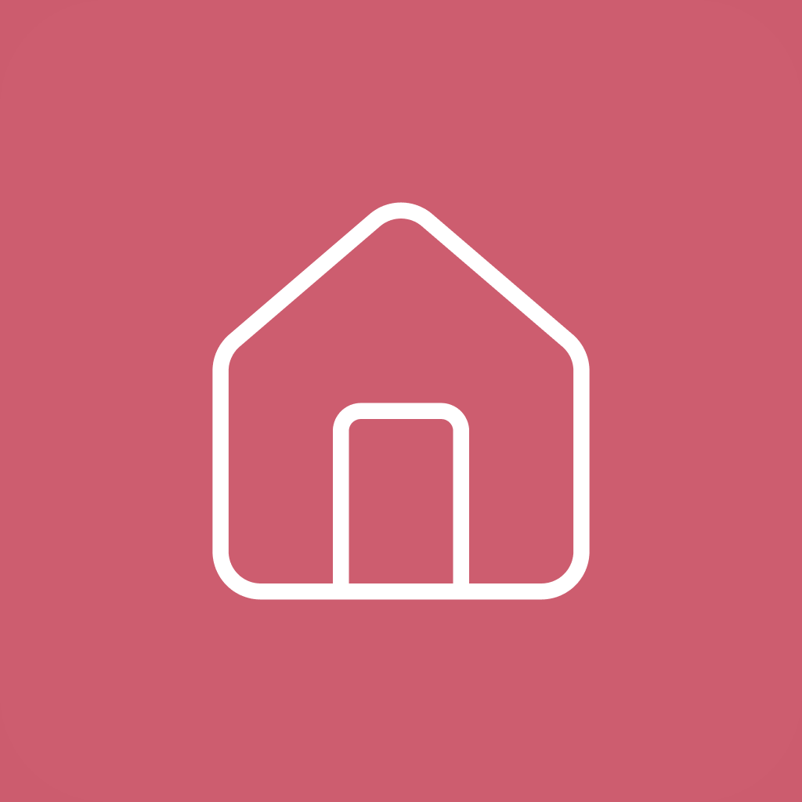
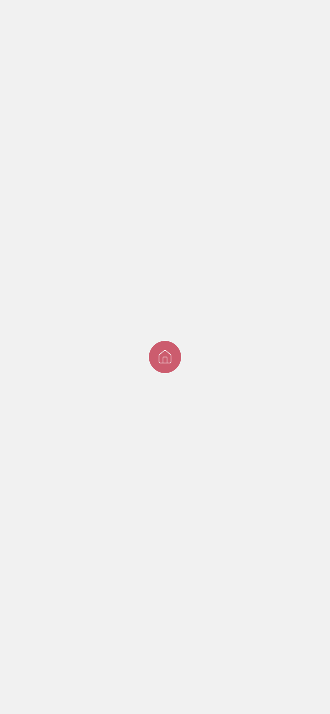

# Inlämning: Hushållet

Hushållet är en skoluppgift, gjord av en grupp på fem personer. Produktägare: David Jensen. Den här filen samlar allt som hör till inlämningen: hur appen testas, vilka krav som är uppfyllda och var appen avviker från skisserna.

Appen beskrivs i [README](../README.md).

## Sammanfattning

- **G:** 20 av 20 obligatoriska krav.
- **VG:** 33 av 40 krav, där 32 krävs, plus CI.

## Testa appen

1. Starta servern och appen enligt [Snabbstart](../README.md#snabbstart). `npm run db:seed` fyller databasen med testdata.
2. Logga in med ett testkonto från [Testkonton](../setup/README.md#testkonton). Alla har lösenordet `test1234`.
3. Anna, Erik, Sara och Johan är aktiva i två hushåll var och väljer hushåll vid första inloggningen. Maja väntar på godkännande i Kompisar.

Kryssrutorna i kravlistan nedan visar vad som är klart i main. Avvikelser från skisserna står under [Avvikelser från skisserna](#avvikelser-från-skisserna).

## Appikon och splash

Appikonen och splashen syns bara i en riktig build (`npx expo run:android`), inte i Expo Go. Så här ser de ut:

  
  &nbsp;&nbsp;
  

Ikonen är `mobile/assets/images/icon.png`. Splashen visar `splash-icon.png` på bakgrunden `#F1F1F1`, enligt `app.json`.

## Avvikelser från skisserna

Kravet säger att designen ska utgå från skisserna, och att undantag diskuteras med produktägaren, godkänns och dokumenteras. Tabellen visar var appen skiljer sig från Figma. Appen följer skisserna: samma skärmar, samma rosa färg (`#CC5C6E`), ljusgrå bakgrund (`#F1F1F1`) och vita kort. Fyra avvikelser märks när man använder appen: headern, statistiken, profilen och rullgardinsmenyerna i Skapa syssla. Tabellen visar alla, jämförda med Figma den 28 oktober.

Mindre stilfel är rättade i [#132](https://github.com/04luknie-nemo/Household/issues/132): hushållets namn i headern, den tomma dagsvyn och statistiken, hushållets kort, att bara ägaren ser anslutningskoden, en etikett i Skapa hushåll och korten i detaljvyn.

| Skärm        | Skissen                                                                | Appen                                                                                  | Varför                                                                                        | Godkänd av David |
| ------------ | ---------------------------------------------------------------------- | -------------------------------------------------------------------------------------- | --------------------------------------------------------------------------------------------- | ---------------- |
| Header       | Bokstaven P för profil och ett hus i en rosa ruta för att byta hushåll | Ikoner för profil och byt hushåll                                                      | Ikonerna förklarar sig själva och kommer från samma ikonbibliotek som resten av appen         | 2026-10-29       |
| Splash       | Huset i en rosa cirkel med texten Hushållet under                      | Bara huset i en rosa cirkel. Syns inte i Expo Go, bara i en riktig build               | Expo Go visar sin egen. Se bilderna under [Appikon och splash](#appikon-och-splash)           | 2026-10-29       |
| Statistik    | Emoji inne i varje tårtbit                                             | Emoji och poäng under varje diagram                                                    | Smala bitar blev oläsliga, och poängen visar vikten                                           | 2026-10-29       |
| Statistik    | Även perioderna oktober och 2020                                       | Denna vecka, förra veckan och förra månaden. Tomma perioder visas inte                 | Följer kravlistan                                                                             | 2026-10-29       |
| Skapa syssla | En rad med siffror för återkommer och värde                            | Rullgardinsmenyer                                                                      | Får plats på smala skärmar                                                                    | 2026-10-29       |
| Profil       | Kortet Kontaktuppgifter med namn och e-post, båda med penna            | Kortet Hushåll med smeknamn och penna, och kortet Konto med namn och e-post utan penna | Smeknamn och avatar gäller per hushåll. Namn och e-post kommer från kontot vid registreringen | 2026-10-29       |
| Profil       | Avatarerna, Spara och Avbryt visas hela tiden                          | Avatarerna, Spara och Avbryt visas när man trycker på pennan                           | Sidan blir kortare när man bara vill se profilen                                              | 2026-10-29       |
| Profil       | Ingen knapp för att logga ut                                           | Knappen Logga ut längst ner                                                            | Användaren behöver kunna logga ut, och profilen är kontots sida                               | 2026-10-29       |
| Profil       | Knapp för mörkt läge                                                   | Inget mörkt läge                                                                       | VG-krav som gruppen valt bort                                                                 | 2026-10-29       |
| Hushåll      | E-post eller smeknamn under varje medlem                               | Bara smeknamnet                                                                        | Servern skickar inte e-post till andra medlemmar                                              | 2026-10-29       |
| Hushåll      | Knapparna Pausa och Återuppta på en medlem                             | Finns inte                                                                             | VG-krav som gruppen valt bort                                                                 | 2026-10-29       |
| Hushåll      | Egen sida för en medlem med Gör till ägare                             | Knapp på medlemsraden (#107)                                                           | Ett tryck i stället för två                                                                   | 2026-10-29       |
| Hushåll      | Koden ser ut som HEM-4821                                              | Koden ser ut som ABC234, som på skissen Hushåll skapat                                 | Sex tecken utan förväxlingsbara tecken                                                        | 2026-10-29       |

Produktägaren David Jensen har gått igenom och godkänt alla avvikelser. Sista genomgången före inlämningen gjordes samma dag.

### Skärmar vi designat själva

Välj hushåll finns inte i de skisser vi fick. Gruppen designade skärmen i Figma (#115), så den avviker inte från skisserna. En skillnad mot vår egen Figma: knappen Logga ut uppe till höger i headern lades till efteråt, så att den som väntar på godkännande kan logga ut utan att komma åt profilen (#160).

## Krav

Krav markerade med \* är obligatoriska (20 st). G: 20 krav. VG: 32 krav samt CI.

### Kravlista

- [x] En logga, splashscreen och appikon ska designas och användas. \*
- [x] Applikationen ska byggas med RN, Expo och TS. \*
- [x] Designen av appen ska utgå ifrån befintliga skisser. Undantag diskuteras med produktägaren, godkänns och dokumenteras. \* Se [Avvikelser från skisserna](#avvikelser-från-skisserna).
- [x] Information ska kommuniceras till och från en server.

### Hushåll

- [x] Ett hushåll ska ha ett namn och en genererad (enkel) kod så andra kan gå med i hushållet. Namnet ska gå att ändra. \*
- [x] Alla användare i ett hushåll ska kunna se vilka som tillhör ett hushåll.
- [x] En ägare av ett hushåll ska kunna se förfrågningar om att gå med i hushållet.
- [x] En ägare ska kunna acceptera eller neka förfrågningar.
- [x] En ägare ska kunna göra andra till ägare.
- [ ] En ägare ska kunna pausa en användare. Under pausade perioder tas användaren inte med i statistiken.
- [ ] Om en användare har pausats under en del av en period i statistiken ska graferna normaliseras.

### Konto

- [x] En användare ska kunna registrera och logga in sig. \*
- [x] En användare ska kunna skapa ett nytt hushåll. \*
- [x] En användare ska kunna gå med i ett hushåll genom att ange hushållets kod. \*
- [x] När en användare har valt att gå med i ett hushåll behöver en ägare först godkänna användaren.
- [x] En användare ska kunna lämna ett hushåll.

### Profil

- [x] En användare ska kunna ange sitt namn. \*
- [x] En användare ska kunna välja en avatar (emoji-djur och färg) från en fördefinierad lista. \*
- [x] Valda avatarer ska inte kunna väljas av andra användare i hushållet. \*
- [x] Avataren ska användas i appen för att visa vad användaren har gjort. \*
- [ ] En användare ska kunna ställa in appens utseende (mörkt, ljust, auto).
- [x] Om en användare tillhör två eller fler hushåll ska den kunna byta mellan hushållen.

### Sysslor

- [x] En ägare ska kunna lägga till sysslor att göra i hemmet. \*
- [x] En syssla ska ha ett namn, en beskrivning, hur ofta den ska göras (dagar) och en vikt som beskriver hur energikrävande den är. \*
- [ ] En användare ska kunna lägga till en ljudinspelning och en bild för att beskriva sysslan.
- [x] En ägare ska kunna redigera en syssla. \*
- [x] En ägare ska kunna ta bort en syssla.
- [x] När en syssla tas bort ska användaren få en varning om att statistiken för sysslan också tas bort, och få valet att arkivera sysslan istället.

### Dagsvyn

- [x] Alla sysslor ska listas i en dagsvy och ge en översikt kring vad som behöver göras. \*
- [x] Utöver namnet ska vem/vilka som gjort sysslan visas, hur många dagar sedan den gjordes senast och om den är försenad. \*
- [x] När en användare väljer en syssla visas beskrivningen, och med ett enkelt tryck går sysslan att markera som gjord. \*

### Statistik

- [x] En användare ska kunna se fördelningen av gjorda sysslor mellan användarna i sitt hushåll. \*
- [x] Varje statistikvy ska visa den totala fördelningen (med vikterna inräknade) och fördelningen för varje enskild syssla. \*
- [x] Det ska finnas en statistikvy över "nuvarande vecka". \*
- [x] Det ska finnas en statistikvy över "förra veckan".
- [x] Det ska finnas en statistikvy över "förra månaden".
- [x] Om det inte finns statistik för en vy ska vyn inte visas.

### Schemaläggning

- [ ] En ägare ska kunna tilldela och ta bort sysslor från användare i hushållet.
- [ ] Användare ska kunna se de tilldelade sysslorna i sitt gränssnitt.
- [ ] En ägare ska kunna skapa grupper av sysslor som automatiskt tilldelas användarna och roteras baserat på ett intervall i dagar.

## Arbetssätt med AI

Gruppen använder AI-assistenter i projektet. Se [AI-ARBETSSATT.md](AI-ARBETSSATT.md) för hur vi delar upp arbetet och granskar kod.
